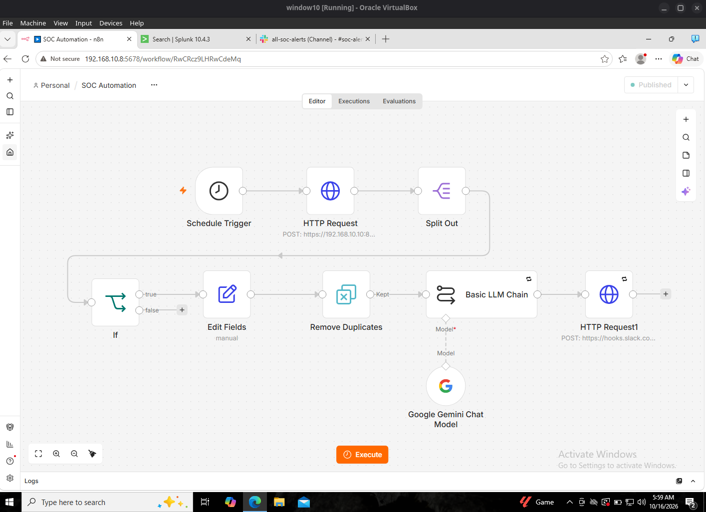
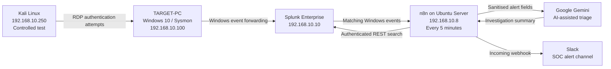

# SentinelFlow — AI-Assisted SOC Detection & Automation

**An end-to-end cybersecurity home-lab workflow that turns Windows authentication telemetry into investigated alerts.**

SentinelFlow is a small, self-hosted SOC automation prototype inspired by MyDFIR's *SOC Automation Project 2.0*. It uses **Splunk Enterprise, n8n, Google Gemini and Slack** to query Windows logs, identify matching activity, generate an AI-assisted triage summary, and notify an analyst without a manual search.

> **Status:** End-to-end lab validation completed on 16 October 2026. This is a controlled proof of concept, not production monitoring or autonomous incident response.

## Demonstrated outcome

A fresh, authorised Hydra test generated **two unsuccessful authentication attempts** against a non-administrator local Windows account. Splunk returned **two Event ID 4625 records** from the Kali test source. At a subsequent scheduled run, n8n processed **one matching 15-minute alert group**, requested a Gemini triage summary, and posted it to Slack.

*Figure 1 — Published n8n workflow connecting scheduled Splunk polling to Gemini-assisted analysis and Slack delivery.*

## Architecture

**Flow:** Windows logs → Splunk search → n8n classification and deduplication → Gemini analysis → Slack notification. The test traffic originated from Kali. The machines were connected to an isolated-soc-lab VirtualBox NAT Network with possible outbound internet connectivity; the environment was not air-gapped.

## Technology stack

| Component | Role |
| --- | --- |
| Windows 10 (`TARGET-PC`) | Standalone/workgroup test endpoint; Windows Security events and Sysmon |
| Kali Linux | Authorised authentication test source |
| Splunk Enterprise 10.4.3 | SIEM, `endpoint` index, REST search API |
| Ubuntu Server, Docker Compose | Runs self-hosted n8n Community Edition |
| n8n | Schedules queries, filters, formats, deduplicates and routes alerts |
| Google Gemini API, free-tier model | AI-assisted triage summary and investigation suggestions |
| Slack Incoming Webhooks | Delivers SOC notifications and workflow-error messages |

Lab IPs are examples from this deployment, not public service addresses. The primary n8n service is accessible on the lab network at port `5678`; Splunk Web and management API use ports `8000` and `8089` respectively.

## Detection and workflow

1. **Schedule Trigger:** every 5 minutes.
2. **Splunk REST API (HTTP Request):** `POST /services/search/jobs` with `exec_mode=oneshot`; returns detection search results.
3. **Split Out:** converts the API's `results` array into individual findings.
4. **IF:** checks the threshold on each finding.
5. **Edit Fields:** builds a structured alert with source IP, host, count and time bucket.
6. **Remove Duplicates:** filters alert keys previously processed by the workflow.
7. **Basic LLM Chain + Gemini:** writes a concise SOC triage summary based on supplied evidence.
8. **Slack HTTP Request:** sends the analysis to a lab channel.
9. **Separate Error Workflow:** sends a Slack error notification for failed n8n executions; tested using a deliberately failing JavaScript node.

**Demonstration-specific detection:** `soc_test` failed logons originating from `192.168.10.250`, at least **2** failures in a completed fixed 15-minute bucket. The IF threshold was also **2**, with severity marked **Lab Test**. These low thresholds and filters were intentionally retained for this demo. They are **not production brute-force thresholds**.

See [`detections/failed-logons-lab.spl`](detections/failed-logons-lab.spl) for the documented SPL and [`docs/detection-and-analysis.md`](docs/detection-and-analysis.md) for its assumptions.

## Fresh end-to-end validation

| Evidence | Observed result |
| --- | --- |
| [02 — Hydra test](screenshots/02-kali-hydra-controlled-test.png) | Two deliberately incorrect password candidates; zero valid credentials found |
| [03 — Splunk failures](screenshots/03-splunk-failed-logons.png) | Two matching Event ID 4625 events on `target-PC` from `192.168.10.250` |
| [04 — n8n scheduled execution](screenshots/04-n8n-scheduled-alert-delivery.png) | One finding passed through IF, deduplication, Gemini and Slack nodes |
| [05 — Slack notification](screenshots/05-slack-ai-soc-notification.png) | AI-generated summary arrived in the SOC alerts channel |
| [06 — Deliberate workflow error](screenshots/06-n8n-error-handler-test.png) | n8n saved a deliberately failed test execution |
| [07 — Slack error notification](screenshots/07-slack-error-notification.png) | Error handler delivered the failed node, error message and execution link |

Read the evidence-backed write-up in [`docs/validation-results.md`](docs/validation-results.md) and the incident narrative in [`docs/investigation-case-study.md`](docs/investigation-case-study.md).

## Repository navigation

- [`docs/architecture.md`](docs/architecture.md) — hosts, components, networking and data flow
- [`docs/implementation.md`](docs/implementation.md) — setup and workflow configuration overview
- [`docs/detection-and-analysis.md`](docs/detection-and-analysis.md) — SPL, threshold and grouping logic
- [`docs/investigation-case-study.md`](docs/investigation-case-study.md) — fresh controlled attack and investigation
- [`docs/validation-results.md`](docs/validation-results.md) — results and screenshots
- [`docs/error-handling.md`](docs/error-handling.md) — retry settings and controlled failure test
- [`docs/limitations.md`](docs/limitations.md) — honest reliability, licensing and security limitations
- [`docs/evidence-index.md`](docs/evidence-index.md) — screenshot descriptions
- [`workflows/README.md`](workflows/README.md) — how to export the actual n8n workflows safely
- [`deployment/README.md`](deployment/README.md) — example self-hosted n8n deployment files

## Scope and limitations

- This is **lab-specific detection**, not a claim to identify all password attacks. The fixed 15-minute buckets can split attempts across boundaries.
- The AI provides **advice only**; it does not automatically block accounts, isolate hosts or perform response actions. AI conclusions require human review.
- Duplicate suppression happens **before Slack confirms delivery**. Retries and error notifications mitigate failures but do not provide exactly-once delivery.
- The prototype used an **active Splunk Enterprise trial**. Continued API access/alerting after its expiry was **not validated**; no claim of a permanently free end-to-end Splunk setup is made.
- Lab HTTP endpoints, the Splunk self-signed certificate exception and basic authentication were acceptable only within the user's controlled environment, not intended for Internet exposure.
- The local n8n workflow export is **not included** until it can be exported and reviewed for embedded secrets or private configuration.

## Reference and attribution

The build was inspired by [MyDFIR](https://www.youtube.com/@MyDFIR) and the *SOC Automation Project 2.0* tutorial. Credit for the learning path belongs to the original creator. The VM setup, controlled tests, Splunk evidence, n8n workflow and findings documented here are from my own lab.

**Safety:** All testing described here took place on systems owned or authorised for use in the isolated training environment. Do not reuse the lab credentials, screenshots, webhook addresses or API configuration in a public service.
