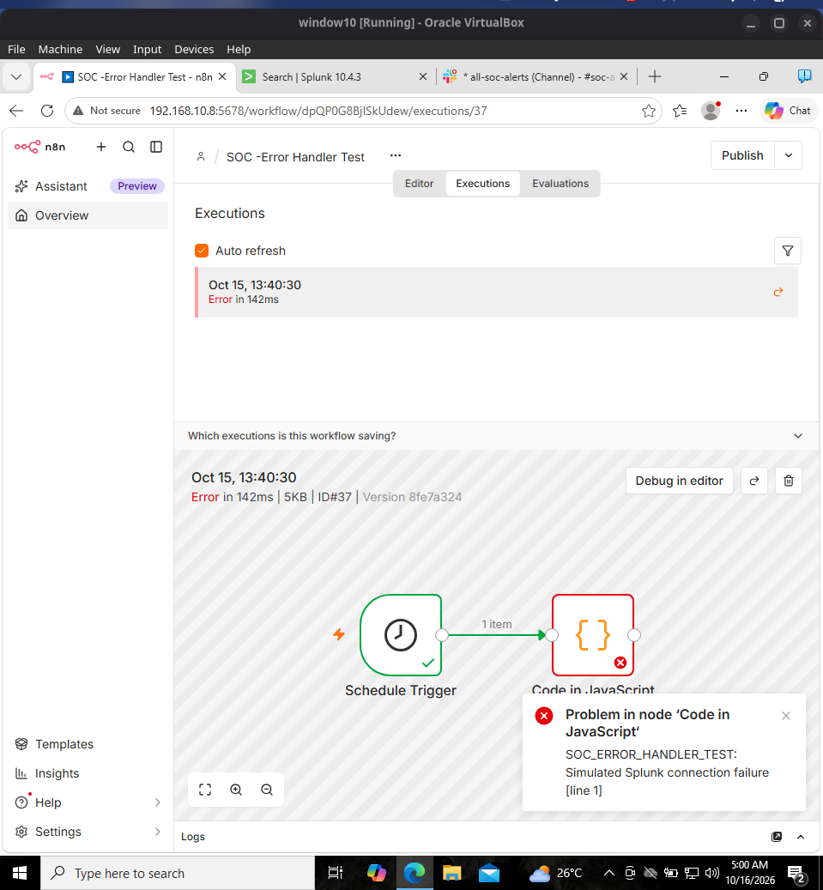
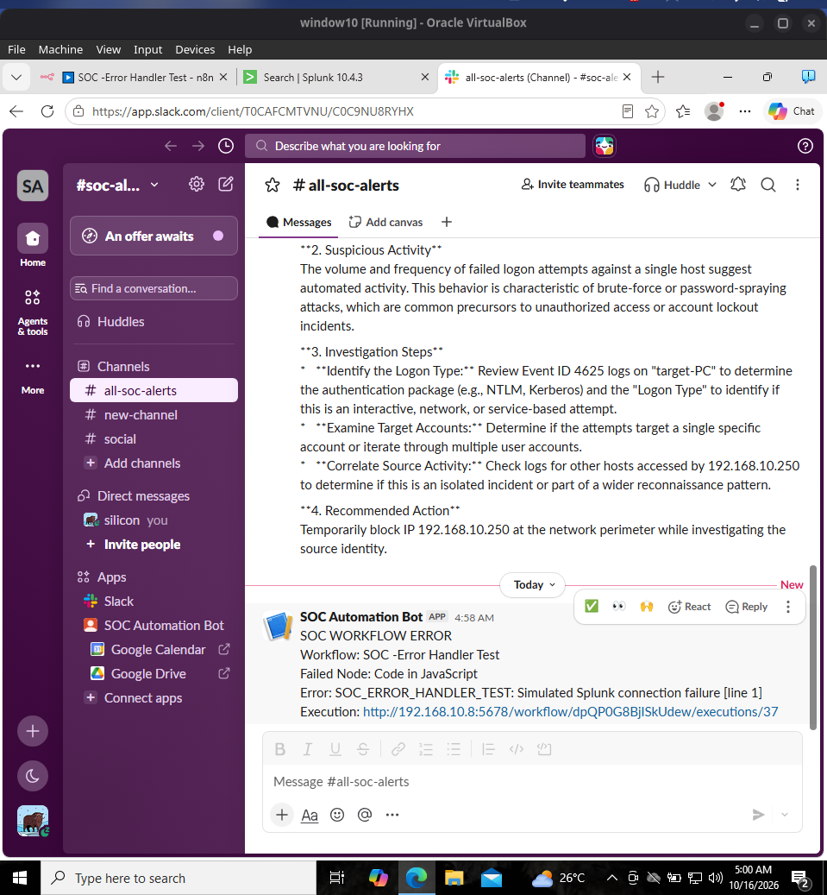

# Error handling and failure-notification test

A separate n8n Error Trigger workflow sends a Slack message with the originating workflow, last executed node, error string and execution URL if an eligible scheduled execution fails.

The main workflow was configured with retries (up to three tries, with a wait between attempts) for Gemini and the Slack HTTP Request. These settings reduce the impact of transient errors but do not guarantee delivery.

## Controlled test

A **separate temporary test workflow**, not the production-like lab workflow, used a scheduled Code node that deliberately raised:

```javascript
throw new Error('SOC_ERROR_HANDLER_TEST: Simulated Splunk connection failure');
```

The n8n execution displayed a failure and Slack received an error notification naming the failed JavaScript node and the test error.





## Boundaries

- A successful HTTP response containing an unexpected empty result is not automatically flagged as a workflow failure.
- An offline n8n server cannot execute its own Error Trigger.
- Remove Duplicates currently marks alerts before Slack confirms successful delivery, so a failed delivery may not be retried as a new alert on the next run. This is a **known limitation**, not silently fixed by the retry setting.
- The temporary failing test workflow should remain disabled after validation.
