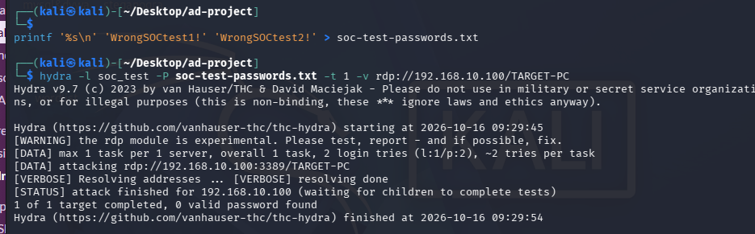
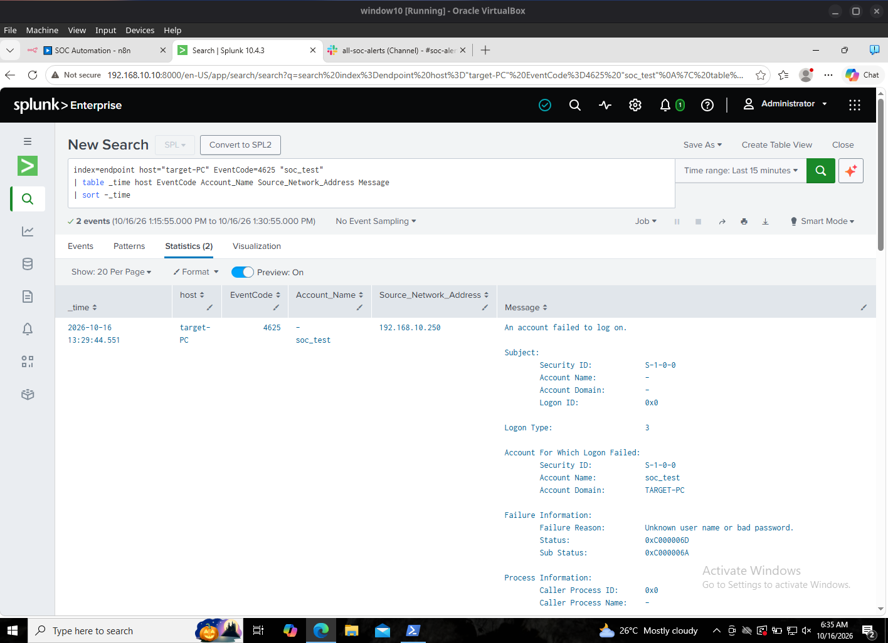
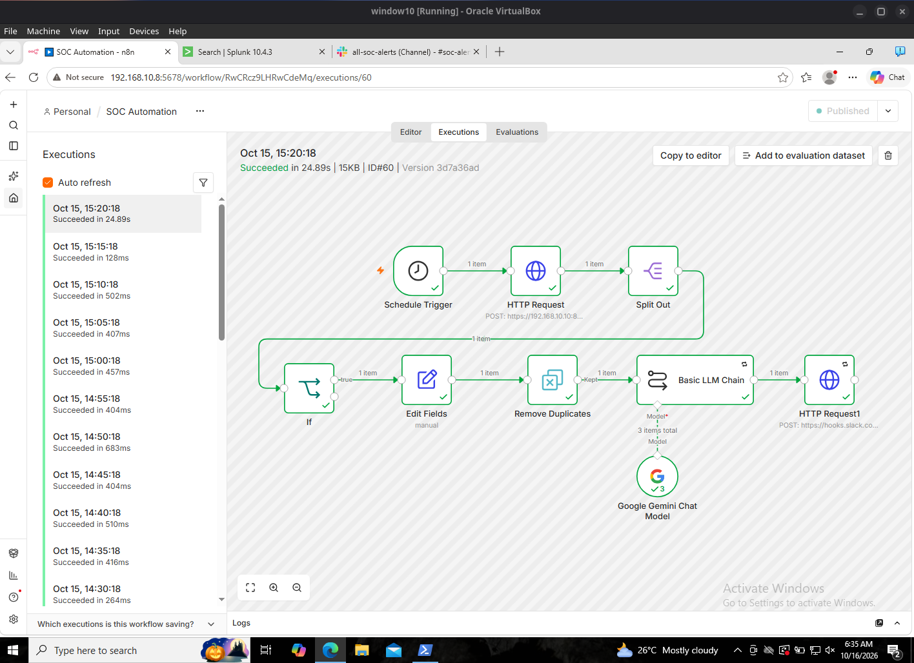
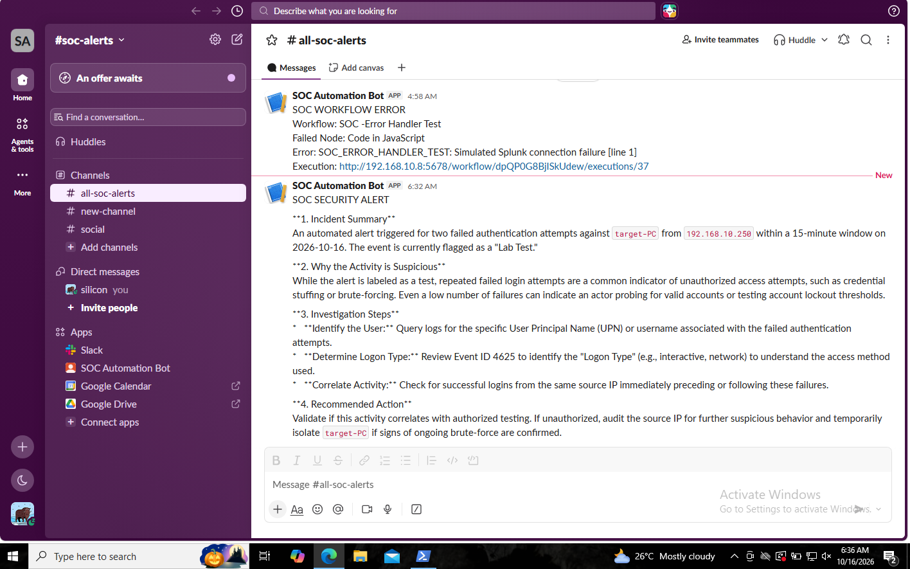

# Case study — Automated triage of failed Windows logons

## Objective

Verify that a fresh, authorised authentication test can be followed from the Kali test host through Windows logging, Splunk, scheduled n8n processing, Gemini analysis and Slack delivery.

## Scope

- Source: Kali Linux (`192.168.10.250`)
- Destination: Windows 10 `target-PC` (`192.168.10.100`)
- Account: local **non-administrator** `TARGET-PC\soc_test`
- Date: 16 October 2026 (lab screenshots)
- Method: two deliberately incorrect RDP password candidates using Hydra, single task.

## Observed sequence

**1. Activity generated** — A short two-entry test password list was used. Hydra completed one target and reported **zero valid passwords**. No successful credential compromise is claimed.

**2. Windows events indexed** — Splunk returned **two matching Windows Event ID 4625 records** against the local test account; visible source IP `192.168.10.250`, Logon Type 3, and substatus `0xC000006A` consistent with incorrect credentials.

**3. Scheduled pipeline executed** — A published n8n schedule queried Splunk, split the matching results, evaluated the IF condition, applied deduplication, generated a Gemini summary, and completed a Slack webhook request. The recorded workflow showed **one processed detection group**, not two independent alerts.

**4. Analyst notification** — Slack displayed a new alert summarising two failed authentication events with investigation suggestions. These are model-generated recommendations for human review, not actions the system actually performed.

## Outcome

**PASS (for this controlled lab scenario).** The end-to-end flow was demonstrated on fresh data. This does not establish production reliability, credential compromise, autonomous blocking or coverage of unrelated usernames/source IPs.

## Follow-up assessment

A SOC analyst would validate account ownership, failure reasons, logon types, scope of the source address, and any subsequent successful logons before deciding whether containment is appropriate. The test was authorised and intentionally low volume.
